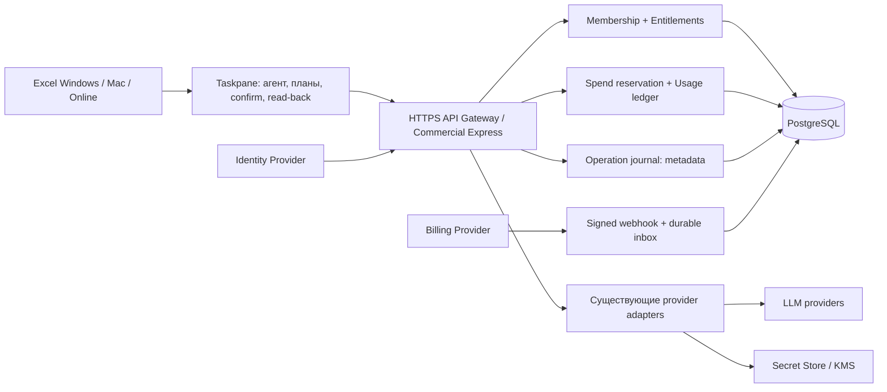

# am.AI — минимальная коммерческая архитектура

Статус C0: предложение от 7 ноября 2026; **8 ноября пользователь утвердил начало C1 по этой архитектуре**. База реализации обновлена до опубликованной 1.0.48; отсутствие `main` и исторический аудит `production` сохранены в C0. C0 сам по себе не менял runtime. Имена файлов/API/таблиц ниже описывают целевой проект; фактически реализованный test scope, зависимости и оставшиеся ограничения приведены в [C1_PROGRESS.md](C1_PROGRESS.md).

## 1. Решение и границы

Сохранить Excel executor в taskpane. Добавить отдельный коммерческий entrypoint на TypeScript/Express, используя существующие wire-format адаптеры. Начать с **модульного монолита + PostgreSQL + управляемого хранилища секретов**; отдельные микросервисы, Redis и очередь сообщений на C1 не обязательны. Один public HTTPS origin раздаёт cloud taskpane и API; локальная Windows-редакция остаётся отдельным режимом.

Существующее основание: [server](../../server/src/server.ts), [protocol](../../server/src/protocol.ts), [providers](../../server/src/providers.ts), [agent](../../src/agent/loop.ts), [plans](../../src/excel/plans.ts). Не делать публичным нынешний local server заменой bind/Origin: его stores глобальны и не знают tenant. Не переписывать Excel-функции ради SaaS.

Public gateway никогда не получает прямое управление Excel. Клиентские результаты операций — сообщения клиента, не независимое доказательство сервером содержимого книги. Книга/история не загружаются в облако целиком по умолчанию. Провайдер получает выбранные messages/tool results: существующий поток описан в [аудите](C0_AUDIT.md).

## 2. Gateway и серверная лицензия

Порядок каждого AI-запроса:

1. Проверить токен/сессию, issuer, audience, срок и status; определить `userId` по проверенной identity. Не доверять userId из body.
2. Проверить активное membership в выбранной организации; `orgId` в URL/header — только запрошенный контекст, не доказательство членства. Вывести роль и tenant policy.
3. Прочитать server-side subscription/entitlements. Проверить plan, seats, provider/model, BYOK policy, account block. Клиентская кнопка и кэш лицензии не авторизация.
4. Ограничить body, nested messages/tools, context tokens, output tokens, время, concurrent requests; отвергнуть неизвестную модель/URL/credentialRef. Публиковать только поддерживаемые схемы инструментов по версии протокола.
5. Атомарно зарезервировать бюджет в БД. Без reservation upstream не вызывается.
6. Создать provider attempt и получить credential только внутри tenant context; отправить запрос и SSE с requestId.
7. Завершить/пометить неопределённость ledger независимо от disconnect клиента. Записать метаданные и выдать остаток квоты без секрета/содержимого книги.

Новые endpoints: `GET /api/v1/me`, `GET /api/v1/orgs/:orgId/entitlements`, `POST /api/v1/orgs/:orgId/chat`, usage, keys, operations. Existing `/api/chat` остаётся local-only. Provider compatibility сохраняется в [openaiRoute](../../server/src/openaiRoute.ts), [Responses](../../server/src/responsesApi.ts), [Anthropic](../../server/src/anthropicApi.ts), но transport/credentials инжектируются per-request.

Отказ auth/ledger/entitlements должен запрещать **новый платный запрос**. Уже начатая Excel-запись завершается безопасным read-back; доступ к локальной отмене и восстановлению не блокируется из-за истечения подписки. Кэш лицензии ограничен по TTL; отзыв членства проверяется на новом запросе, не вечно по claims.

Open-source клиент можно модифицировать: серверная лицензия защищает hosted AI/сервисы, а не делает локальные Excel-функции неотключаемо платными. Существующие local/direct BYOK пути сохраняются явно как отдельная редакция; SaaS-лимиты на них технически не обещаются. Основание: [LICENSE](../../LICENSE), [webProvider direct transport](../../src/taskpane/api/webProvider.ts).

## 3. Пользователи и организации

Личный пользователь получает personal organization и membership owner; Team/Business используют ту же модель данных. Роли: owner (billing, transfer ownership), admin (members/policy/keys), member (AI/свои операции), viewer (read-only, без AI spend по умолчанию). Права задаются матрицей, не порядком ролей в enum. Пользователь может состоять в нескольких org; переключение меняет scope всех запросов/кэшей. Нельзя убрать последнего owner.

| Таблица | Ключевые поля/инварианты |
| --- | --- |
| users | id, externalSubject, status; identity без собственного password store |
| organizations / memberships / invitations | orgId, userId, role, status; unique membership; expiry и одноразовый invite token hash; seat reservation под lock |
| subscriptions / entitlement_versions | orgId, plan, status, period, seats, version; provider-agnostic projection |
| provider_credentials | orgId, ownerUserId при personal key, providerId, secretRef, version, status; чужие refs недоступны |
| usage_requests / usage_attempts | org/user/requestId, keyMode, provider/model, pricingVersion, usageState, actual tokens/cost; каждая попытка отдельно |
| budget_accounts / budget_reservations / usage_ledger | org, period, валютные integer units, requestId; unique dedupe; atomic reserve/finalize |
| operation_events | org/user, client/session/task/operation IDs, sequence, tool/version, workbook pseudonym, executionState, undo status; append-only |
| billing_customers / billing_events | org, provider external ID, eventId unique, payloadHash, state, retry metadata |
| outbox | durable события для billing/observability, delivery retry и idempotency |

Все tenant-owned запросы используют `(orgId, id)`, включая list, downloads, object refs и exports. Composite foreign keys препятствуют cross-tenant ссылкам. PostgreSQL row-level policies — дополнительная защита после проверки с пулом соединений; primary boundary — серверный membership+scoped repository. Нужны adversarial tests двух организаций. Текущие [MemoryStore](../../server/src/memoryStore.ts), [FileStore](../../server/src/files/fileStore.ts), [BackupRoutes](../../server/src/backupRoutes.ts) не становятся multi-tenant от добавления orgId в UI.

## 4. Free, Pro, Business, Team

Матрица — предложение продукта. Цены, реальные квоты и merchant/jurisdiction **не утверждены**. До их задания денежный hosted budget равен нулю, исключение — явно выданные ограниченные pilot credits. «Безлимитный AI» не предлагается.

| Возможность | Free | Pro | Business | Team |
| --- | --- | --- | --- | --- |
| Организация / места | personal, 1 | personal, 1 | организация, договорное число мест | общая организация, оплаченные места |
| Hosted AI | Небольшой trial budget, только после назначения чисел | Месячный budget | Contract budget / procurement policy | Общий org budget + member caps |
| BYOK | Personal key, квота сервиса | Personal key | Org keys и policy | Org/personal keys по policy |
| Модели | Все существующие адаптеры сохранены; доступ через явную server policy | То же | То же | То же |
| Журнал и recovery | Базовые безопасность и локальная отмена | Расширенная история | Retention/export policy | Общий admin audit |
| Контроль | Один пользователь | Собственные лимиты | Admin policy, сроки хранения | Роли, seats, индивидуальные лимиты |

Business — требования управления/закупок; Team — совместная работа и seats, это разные коммерческие SKU, не неявная лестница. Нужны утверждённые feature flags и finite budgets по каждому SKU. Платность не должна отключать базовые проверки записи/отмену. Модели не удаляются из существующего реестра.

## 5. Usage metering и предел расходов

Переиспользовать [normalizeUsage / UsageScanner](../../server/src/usageMetrics.ts) как parser. Не использовать RAM `MetricsStore` или [UI prices](../../src/taskpane/api/prices.ts) как денежный ledger.

- `Idempotency-Key` уникален в org+endpoint; сохранять hash нормализованного запроса. Повтор с другим body → 409; параллельный повтор не создаёт второй upstream. Повтор stream не возвращает новый платный запрос; состояние/неполученный текст показываются отдельно.
- До отправки вычислить консервативную верхнюю границу: bounded input tokens, максимум output/reasoning/cache-write, максимальное число попыток и версия цен. Нельзя гарантировать бюджет для модели без известной верхней границы стоимости: такой hosted маршрут отклоняется или допускается только по отдельно утверждённому BYOK policy.
- Атомарная транзакция проверяет `spent + reserved + newReservation <= cap` для org, user, периода и global provider budget. Денежные значения — целые micro-units с currency, не float. Смена месяца не переносит старую reservation в чужой период.
- У каждого фактического upstream attempt собственный ID и учёт, включая SDK retries и route fallbacks. Скрытые retries отключить/инструментировать в коммерческом wrapper; сохранение адаптеров не означает слепое копирование `maxRetries` текущего server.
- Статусы reservation: `reserved → dispatched → settled` либо `uncertain`. При сбое до отправки безопасно release; после отправки без usage нельзя превращать стоимость в ноль. Держать conservative reserve, сверять с provider invoice/usage API при наличии; если достоверная сверка невозможна, фиксировать bounded conservative charge по согласованной policy.
- Fencing/lease и durable dispatched marker препятствуют повторной отправке при crash. Если неизвестно, принял ли provider запрос, автоматический платный replay запрещён без provider idempotency. TTL не освобождает uncertain spend автоматически.
- Ограничения concurrency, времени и output действуют также для BYOK, но provider spend и сервисная квота учитываются раздельно. BYOK charge не списывается из hosted credits; BYOK не означает обход org policy.
- Цены versioned на сервере; provider-reported cost отделяется от calculated estimate и конечной customer charge. Usage без данных маркируется unknown. Превышение прогноза — incident/global circuit breaker, а не тихое отрицательное сальдо.

Пороговые notifications предложены на 50/80/100% бюджета, с остановкой новых затрат на 100%. Суммы и токен-пределы должны быть настроены и проверены до включения hosted AI.

## 6. BYOK и секреты

Два явных режима: `hosted` (ключ платформы, credits) и `byok` (ключ пользователя/org, service limits). Режим и credential ownership выбирает сервер после membership; модель не выбирает произвольный секрет.

Hosted secrets: secret manager/KMS envelope encryption, ciphertext/ref в БД, associated context org+provider+credentialVersion, наименьшие IAM permissions, ротация и отзыв. В UI только hint/status; никакой обратной выдачи plaintext. Не хранить ключи платформы в bundle, localStorage, логах, operation events или BillingProvider metadata. Передача BYOK на сервер требует явного описания хранения и удаления; доказать удаление ref/caches и правила backup retention.

Windows DPAPI [сохраняется](../../server/src/dpapi.ts) для локального режима. Web localStorage [остаётся отдельным legacy mode](../../src/taskpane/api/webProvider.ts); hosted taskpane использует серверный vault и identity flow. Для hosted режима credential не должен мигрировать из localStorage автоматически. Собственные endpoints разрешать только после server validation и egress policy; не давать произвольный URL с org key. Ollama остаётся локальной возможностью, не открывается в сеть ради SaaS.

Identity: предпочтительно внешний OIDC-провайдер; Authorization Code + PKCE в поддержанном Office dialog/browser flow, строгие redirect origins и state/nonce. Конкретный vendor не выбран. Refresh credentials не хранятся в localStorage; способ безопасной сессии/BFF, cookie restrictions и Office dialog проверяются на Windows/Mac/Online в C2. Auth cookies требуют CSRF защиты; browser access tokens — короткоживущие, в памяти. Session persistence после reload — через поддержанный auth flow, не через постоянный bearer в URL. Нынешний [panel token](../../src/taskpane/api/panelToken.ts) — local IPC token, не SaaS identity.

## 7. Excel-журнал и восстановление

Сохранить [plans](../../src/excel/plans.ts), [undo](../../src/excel/undo.ts), [revision/context](../../src/excel/workbookContext.ts) и [workbook lock](../../src/taskpane/workbookLock.ts). Добавить observer/storage adapters вокруг них, не переносить execution на сервер.

Перед записью сохранить локально durable operation intent и доступный recovery snapshot; в облако отправлять минимальные события. Псевдоним workbook должен быть случайным, без полного пути/имени файла; значения ячеек и формулы не входят в технический журнал. Если включён облачный recovery, snapshots/full backups шифруются отдельно и загружаются только по opt-in с tenant ACL/retention. В C1 облачное хранение книги не требуется.

Жизненный цикл: `prepared → approved → executing → verified | applied | unknown | failed_before_write | rejected`; последующая отмена — отдельное событие `rollback_requested → rolled_back | rollback_conflict | rollback_failed`. Client sequence + unique operation/event ID устраняют дубликаты; после reload executing/неподтверждённое — unknown, сначала re-read/reconcile, не повторная запись.

Rollback — компенсирующее действие с повторной проверкой before/after/версии. Нельзя обещать ACID-транзакцию Excel или отменять поверх новых ручных/совместных правок. Для structural/неотменяемых операций: verified backup и понятный restore path, либо явное решение пользователя о риске. В web-host без подтверждённого export API не обещать полную копию: предложить Save a Copy/host version history и проверить восстановление. Если гарантии нет, блокировать соответствующую commercial destructive operation или требовать утверждённый fallback; local функции сохраняются.

Отключение сети не должно прерывать атомарную часть уже начатой записи или превращать её в успех. Если local intent нельзя сохранить, новые commercial записи fail closed; при недоступном cloud журнале события копятся локально в ограниченной очереди с последующей отправкой. Эти изменения относятся к C3, а не внедряются в C0.

## 8. Billing Provider

Абстракция `BillingProvider`: `createCheckout`, `createCustomerPortal`, `verifyAndNormalizeWebhook(rawBody, headers)`, `fetchSubscription`, `reconcile`. В домене только нормализованные customer/subscription/plan/status/period/seats; provider-specific поля остаются в adapter.

Подтверждённый webhook проходит проверку подписи **сырых байтов**, временного окна и idempotency до изменения состояния. Durable inbox с unique `(provider, eventId)`, out-of-order reconciliation, retries и transaction/outbox. Browser redirect успешной оплаты не выдаёт лицензию. Portal/checkout привязаны к org через server role check; orgId из платежной metadata сам по себе не доверенный.

В C2 только admin-assigned test entitlements и fake BillingProvider. C4 — sandbox выбранного провайдера, тесты refund/cancel/past_due/upgrade/downgrade/seat changes и сверка. Live credentials, налоги/инвойсы, доступность merchant и география запуска — отдельные решения перед live payments, не догадки аудита. Здесь нет реальных платёжных ключей и выбора конкретного merchant.

## 9. Мониторинг, эксплуатация и зависимости

Сохранить числовые usage/latency метрики; добавить requestId, org pseudonym, model/version, attempt count, time-to-first-byte, error class, spend/reserved/unknown. Содержимое prompt/tool args и секреты редактируются до логирования. Сейчас есть [общий console.error](../../server/src/server.ts); его нельзя без проверки отправлять в hosted logger.

Предложенные beta SLO: 99,5% доступность gateway за 30 дней, p95 собственного auth+quota overhead ≤500 мс при согласованной нагрузке (исключая provider latency), alert unknown spend/ledger mismatch ≤5 мин. Это цели, не измеренные текущие показатели. Managed DB PITR, staging restore drill, runbook и feature kill switches нужны до public beta. Backup RPO ≤24 ч / RTO ≤4 ч — предварительная цель для метаданных SaaS, не обещание восстановления текущей открытой Excel-книги.

| Новая инфраструктура / зависимость | Обоснование и ограничение |
| --- | --- |
| PostgreSQL и минимальный драйвер/миграции | Нужны транзакции reservation, durable ledger, memberships, billing inbox; RAM/JSON не подходят. Драйвер/инструмент выбрать в C1 после version/license review; ORM не обязателен |
| OIDC integration library | Нужна корректная проверка identity/token flow; vendor/package — решение C2, не самописная криптография |
| Secret manager/KMS adapter | Защищённое tenant-scoped хранение hosted/BYOK; DPAPI облако не заменяет |
| Billing SDK | Только если raw HTTPS/подписи недостаточны; один adapter, sandbox, решение C4 |
| Observability exporter | Сначала structured logs/metrics; SDK вводить при выбранном backend и redaction tests |
| Object storage / distributed cache / queue | Не требуются для metadata-only C1; добавлять для opt-in backup либо после измеренного bottleneck, с отдельным решением |

## 10. Что должен утвердить владелец до C1

1. Базовая ветка: фактическая `production` вместо отсутствующей `main`; локальный `stage10` не включён.
2. Граница: cloud gateway + клиентский executor, отдельная local/BYOK редакция без обещаний server enforcement для offline-кода.
3. Модульный монолит, PostgreSQL и secret store как минимальные новые компоненты.
4. Матрица SKU, finite trial/monthly/global budgets, BYOK policy и обработка uncertain usage; точные суммы можно утвердить перед включением hosted spend.
5. Retention/opt-in cloud recovery и fallback для необратимых действий на web-host.
6. Пилотные платформы, privacy/merchant geography и допустимые сроки разработки.

После этого выполняется C1 по [ROADMAP](ROADMAP.md). Нет утверждения — нет реализации, merge или production deployment.
